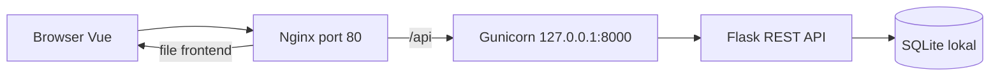

# Cara kerja BankGuard
Awal: simulator → Cloud Functions → Firestore → dashboard; Firebase Auth/IAM mengatur akses.
Prototype baru: browser menjalankan Vue 3 yang disajikan Nginx. Vue meminta /api; Nginx meneruskan ke Gunicorn/Flask, Flask menghitung skor dan menyimpan SQLite.

Seluruh komponen dipasang pada template Ubuntu, lalu digandakan tiga kali. Port host 8081–8083 mengarah ke port 80 masing-masing VM. Database tidak terpusat. Riwayat, data dan login hanya simulasi; bukan sistem bank sungguhan. Node.js hanya diperlukan untuk membuat build Vue, tidak untuk menjalankan hasil build di VM.
