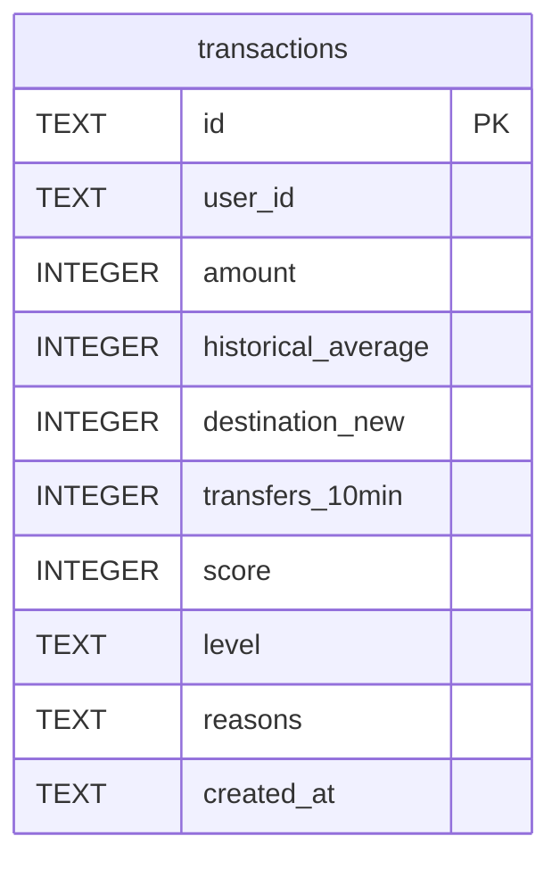

# ERD SQLite (satu tabel)
Sesuai kontrak v0.2; tiap VM menyimpan data terpisah.

UUID dibuat backend; waktu UTC ISO; reasons JSON array; destination_new 0/1 di SQLite dan boolean pada API. Tidak ada tabel akun/foreign key. Lihat backend/schema.sql. Tidak ada integrasi bank atau database terpusat.
